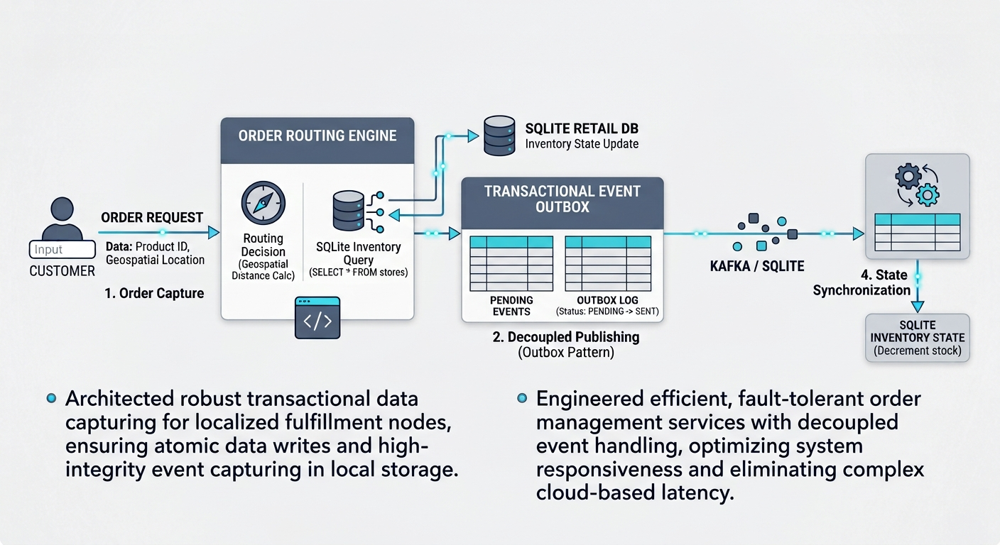

## Event-Driven Omni-Channel Fulfillment & Order Routing Architecture

## Project Overview
An enterprise-grade, event-driven **Distributed Order Management (DOM)** system built in Python, featuring geospatial store routing and the **Transactional Outbox Pattern** to ensure absolute data consistency and fault-tolerant state synchronization.

## Interactive Analytics Dashboard
 

## Features & Tech Stack
* **Geospatial Store Routing:** Leverages object-oriented Python and Euclidean distance calculations to dynamically route customer orders to the nearest fully-stocked fulfillment location.
* **Transactional Outbox Pattern:** Ensures atomic writes between local state changes and event queuing, eliminating lost messages and ensuring guaranteed at-least-once delivery.
* **Decoupled Event Processing:** Separates order intake and routing logic from inventory state synchronization using a persistent event log table (`event_outbox`).
* **High-Integrity State Management:** Atomic database transactions prevent inventory race conditions across multi-node retail networks.

